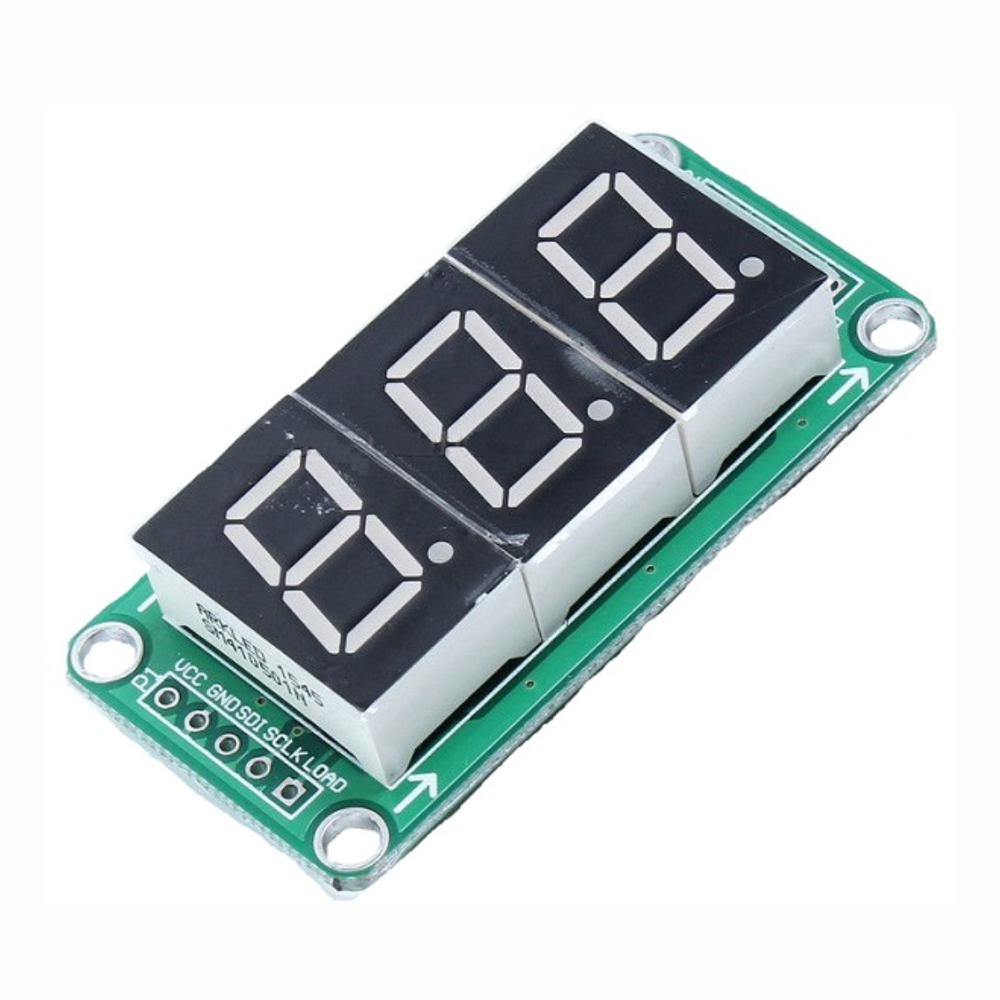
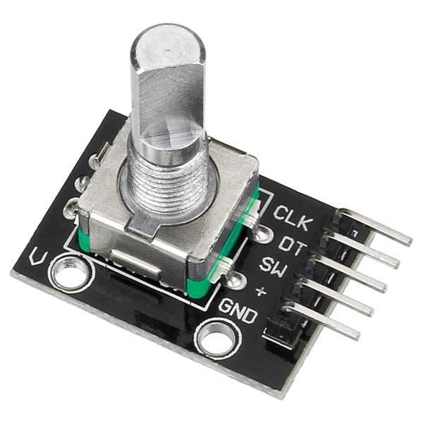
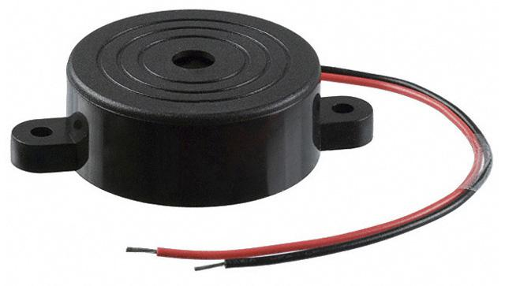
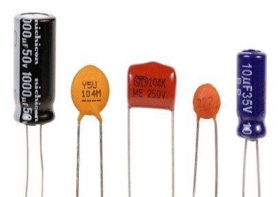
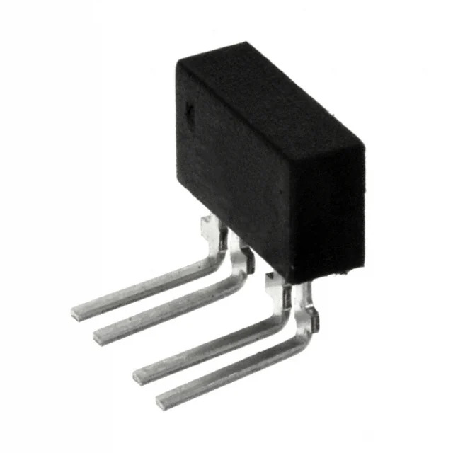
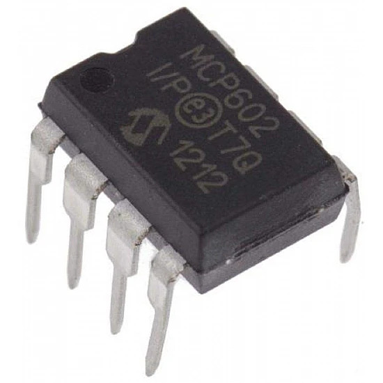
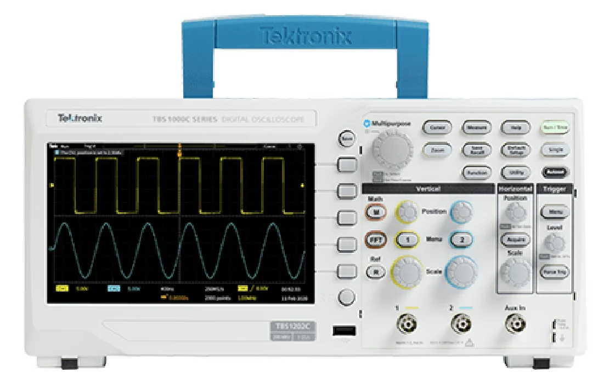
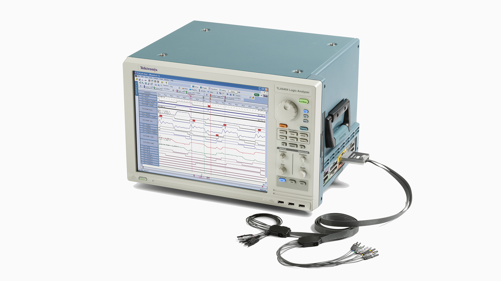

# AVR Embedded Systems — C Lab Projects

A collection of **seven standalone embedded C programs** developed during ELEC1201 laboratory exercises at the **University of Southampton**, covering digital I/O, PWM, analogue-to-digital conversion (ADC), and interrupt-driven programming.

The projects use the **ATmega644P microcontroller** on the **Il Matto development board**, operating at 12 MHz. Each program is compiled and executed independently.

## Projects

| Folder | File | Description |
| --- | --- | --- |
| `Digital-IO` | `counter.c` | Seven-segment display counter (0–9) using software delays. |
| `PWM` | `tone.c` | Generates a 262 Hz tone using Timer1 PWM. |
| `ADC` | `voltage.c` | Measures analogue voltage and outputs readings through UART. |
| `ADC` | `proximity.c` | Optical proximity detection using ADC and LED control. |
| `Interrupts` | `timer.c` | Seven-segment counter using Timer1 interrupts. |
| `Interrupts` | `adc.c` | Continuous ADC sampling and interrupt-driven LED control. |
| `Interrupts` | `external.c` | Increment/decrement counter using external interrupts. |

## Hardware & Equipment

The projects involved microcontroller programming, electronic circuit prototyping, sensor interfacing, and hardware testing.

### Development Board

<p align="center">
  
</p>

### Components

| Component | Image |
| --- | --- |
| Seven-segment LED display |  |
| Rotary encoder |  |
| Piezo speaker |  |
| Resistors |  |
| Capacitors |  |
| TCRT1010 reflective optical sensor |  |
| MCP602 dual operational amplifier |  |

### Testing Equipment

| Equipment | Image |
| --- | --- |
| Oscilloscope |  |
| Logic analyser |  |

*Component images are illustrative references to laboratory hardware and do not necessarily represent completed implementations.*

## Repository Layout

```text
avr-embedded-systems/
├── Digital-IO/
│   └── counter.c
├── PWM/
│   └── tone.c
├── ADC/
│   ├── voltage.c
│   └── proximity.c
├── Interrupts/
│   ├── timer.c
│   ├── adc.c
│   └── external.c
├── common/
│   └── debug.h
├── images/
├── Makefile
├── .gitignore
└── README.md
```

## Requirements

- AVR-GCC toolchain (`avr-gcc`, `avr-libc`, `avr-objcopy`)
- GNU Make
- ATmega644P microcontroller and Il Matto development board
- Compatible UART interface for serial debugging

## Build

Run the following commands from the repository root:

```bash
make                         # Build all seven programs
make list                    # List firmware outputs
make build/ADC/voltage.hex   # Build a specific program
make clean                   # Remove generated files
```

Compiled firmware is stored in the `build/` directory.

The default target is ATmega644P at 12 MHz. Changing the CPU frequency requires reviewing timer calculations and other hardware-dependent settings.

## UART Debugging

`common/debug.h` provides UART0 serial output at **9600 baud**, allowing the ADC programs to print measurements through `printf()`.

The helper is a replacement implementation rather than the original university-provided library.

## Hardware Notes

- Each program contains its own `main()` function and must be compiled separately.
- ADC measurements assume a 3.3 V external reference.
- External interrupt inputs use active-low switches.
- Timer1 examples configure their compare values before starting the timer.
- Hardware functionality and compilation have not been fully reverified.

## Hardware Reference

- **Microcontroller:** ATmega644P
- **Development Board:** Il Matto
- **Seven-Segment Display:** Kingbright SC08-11GWA
- **Datasheet:** [SC08-11GWA](https://www.kingbrightusa.com/images/catalog/SPEC/sc08-11gwa.pdf)

------------------------------------------------------------------------------------------------------------------------------------------------
Developed as part of the **ELEC1201 laboratory exercises at the University of Southampton**, covering digital I/O, PWM, analogue input, and interrupts.
